# AC4 – Brinquedos Esportivos (Spring Boot)

Sistema para uma empresa de brinquedos esportivos para crianças de até 15 anos. O projeto expõe uma API REST com CRUD completo de brinquedos, persistência em banco H2 via Spring Data JPA, validações com Bean Validation, autenticação com Spring Security (perfis **USER** e **ADMIN**) e uma interface web com Thymeleaf (landing page pública, tela de login e painel).

**Integrantes:** Nicolas Mendes (202501027474) e Arthur Franco Siqueira (202501002404)
**IDE:** IntelliJ IDEA

---

## Sumário
1. [Tecnologias](#1-tecnologias)
2. [Como executar](#2-como-executar)
3. [Arquitetura](#3-arquitetura)
4. [Banco de dados](#4-banco-de-dados)
5. [Repository (JpaRepository)](#5-repository-jparepository)
6. [Validações (Bean Validation)](#6-validações-bean-validation)
7. [Segurança (Spring Security)](#7-segurança-spring-security)
8. [Endpoints da API](#8-endpoints-da-api)
9. [Testes de CRUD no Postman](#9-testes-de-crud-no-postman)
10. [Interface web (Thymeleaf)](#10-interface-web-thymeleaf)

---

## 1. Tecnologias

| Tecnologia | Uso no projeto |
|---|---|
| Java 21 | linguagem |
| Spring Boot 4.1.2 (Maven) | base do projeto |
| Spring Web | API REST e controllers das páginas |
| Spring Data JPA / Hibernate | persistência e repositório |
| H2 Database | banco de dados SQL em memória |
| Validation (Bean Validation) | validação dos dados recebidos |
| Spring Security | login, perfis USER/ADMIN e controle de acesso |
| Thymeleaf | páginas HTML (landing, login e painel) |
| Postman | testes dos endpoints |

Configuração inicial gerada no Spring Initializr:

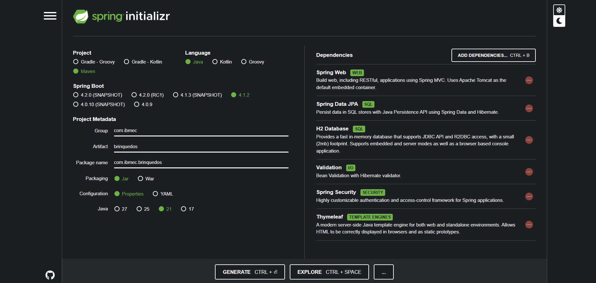

## 2. Como executar

Pré-requisito: JDK 21.

```bash
./mvnw spring-boot:run        # Linux/Mac
.\mvnw spring-boot:run        # Windows
```

A aplicação sobe no Tomcat em **http://localhost:8080**.

| Usuário | Senha | Perfil |
|---|---|---|
| `user` | `user123` | USER |
| `admin` | `admin123` | ADMIN |

> O H2 roda em memória: os dados são apagados sempre que a aplicação é reiniciada.

## 3. Arquitetura

O projeto segue a divisão em camadas: cada uma conversa apenas com a vizinha.

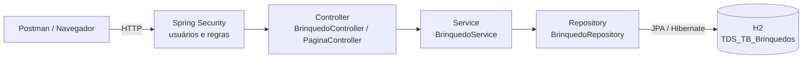

```
src/main/java/com/ibmec/brinquedos
├── BrinquedosApplication.java      classe principal
├── config/SecurityConfig.java      usuários, perfis e regras de acesso
├── controller/
│   ├── BrinquedoController.java    API REST /brinquedos (JSON)
│   └── PaginaController.java       páginas Thymeleaf (/, /login, /painel)
├── exception/
│   ├── BrinquedoNaoEncontradoException.java
│   └── GlobalExceptionHandler.java converte erros em 400 / 404
├── model/Brinquedo.java            entidade (tabela)
├── repository/BrinquedoRepository.java
└── service/BrinquedoService.java   regras de negócio

src/main/resources
├── application.properties          configuração do H2 e JPA
├── static/css/estilo.css
└── templates/ index.html, login.html, painel.html
```

| Camada | Responsabilidade |
|---|---|
| **Controller** | recebe a requisição HTTP, chama o Service e devolve a resposta com o status correto |
| **Service** | regras de negócio (ex.: lançar erro quando o id não existe) |
| **Repository** | acesso ao banco de dados |
| **Model** | a entidade `Brinquedo`, mapeada para a tabela |

## 4. Banco de dados

Configuração em `application.properties`:

```properties
spring.datasource.url=jdbc:h2:mem:brinquedosdb
spring.datasource.username=sa
spring.datasource.password=
spring.jpa.hibernate.ddl-auto=update
spring.jpa.show-sql=true
```

A entidade `Brinquedo` é mapeada para a tabela **`TDS_TB_Brinquedos`** com as colunas obrigatórias:

| Coluna | Tipo Java | Descrição |
|---|---|---|
| `Id` | `Long` | chave primária gerada pelo banco (`IDENTITY`) |
| `Nome` | `String` | nome do brinquedo |
| `Tipo` | `String` | categoria (bola, raquete, patins...) |
| `Classificacao` | `Integer` | idade indicativa, de 0 a 15 anos |
| `Tamanho` | `String` | P, M ou G |
| `Preco` | `BigDecimal` | preço (BigDecimal evita erros de arredondamento com dinheiro) |

Com `ddl-auto=update`, o Hibernate cria a tabela automaticamente a partir da entidade ao subir a aplicação, e `show-sql=true` mostra no console os comandos SQL gerados.

## 5. Repository (JpaRepository)

```java
public interface BrinquedoRepository extends JpaRepository<Brinquedo, Long> {
    List<Brinquedo> findByTipoIgnoreCase(String tipo);
    List<Brinquedo> findByClassificacaoLessThanEqual(Integer idade);
}
```

**Como funciona:**

- `JpaRepository<T, K>` é uma interface do Spring Data JPA. `T` é a entidade (`Brinquedo`) e `K` é o tipo da chave primária (`Long`).
- Não escrevemos nenhuma classe que implemente essa interface: ao iniciar a aplicação, o Spring gera a implementação automaticamente e a injeta no `BrinquedoService` pelo construtor (injeção de dependência).
- Só por estender `JpaRepository`, o repositório já herda os métodos prontos usados no CRUD:

| Método herdado | Uso no projeto | SQL equivalente |
|---|---|---|
| `findAll()` | listar todos | `SELECT * FROM TDS_TB_Brinquedos` |
| `findById(id)` | buscar por id (retorna `Optional`) | `SELECT ... WHERE Id = ?` |
| `save(entidade)` | inserir (id nulo) ou atualizar (id existente) | `INSERT` / `UPDATE` |
| `saveAll(lista)` | inserir vários de uma vez | vários `INSERT` |
| `existsById(id)` | verificar se existe antes de excluir | `SELECT COUNT...` |
| `deleteById(id)` | excluir pelo id | `DELETE ... WHERE Id = ?` |

- `JpaRepository` estende `CrudRepository` (operações básicas) e `PagingAndSortingRepository` (paginação e ordenação), por isso é a opção mais completa.
- Os dois métodos declarados são **consultas derivadas**: o Spring lê o nome do método e monta a consulta sozinho.
  - `findByTipoIgnoreCase("bola")` → `WHERE UPPER(Tipo) = UPPER('bola')`
  - `findByClassificacaoLessThanEqual(10)` → `WHERE Classificacao <= 10` (brinquedos indicados para crianças de até 10 anos)
- Cada chamada de `save`/`saveAll`/`deleteById` roda dentro de uma transação, que recebe o **commit** no banco ao final.

## 6. Validações (Bean Validation)

As regras ficam na própria entidade e são disparadas pelo `@Valid` nos endpoints de POST e PUT:

| Campo | Anotações | Regra |
|---|---|---|
| `nome` | `@NotBlank`, `@Size(max = 100)` | obrigatório, até 100 caracteres |
| `tipo` | `@NotBlank` | obrigatório |
| `classificacao` | `@NotNull`, `@Min(0)`, `@Max(15)` | idade de 0 a 15 anos (público da empresa) |
| `tamanho` | `@NotBlank`, `@Pattern("P\|M\|G")` | apenas P, M ou G |
| `preco` | `@NotNull`, `@Positive` | maior que zero |

Quando alguma regra falha, o `GlobalExceptionHandler` (`@RestControllerAdvice`) devolve **400 Bad Request** com a mensagem de cada campo, em vez de um erro 500 genérico. Brinquedo inexistente devolve **404 Not Found**.

## 7. Segurança (Spring Security)

Configurada em `SecurityConfig`:

- **Usuários em memória** (`InMemoryUserDetailsManager`) com senhas criptografadas por **BCrypt**.
- **Perfis:** `USER` só consulta; `ADMIN` consulta, cria, edita e exclui.
- **Formas de login:** `formLogin` (tela de login própria, para o navegador) e `httpBasic` (para o Postman).
- **CSRF** desativado apenas em `/brinquedos/**` (API usada pelo Postman); continua ativo nos formulários das páginas.

| Endereço | Acesso |
|---|---|
| `/`, `/login`, `/css/**` | público |
| `GET /brinquedos/**` | USER ou ADMIN |
| `POST`, `PUT`, `DELETE /brinquedos/**` | somente ADMIN |
| `/painel` e demais | qualquer usuário logado |

Respostas de segurança:
- **401 Unauthorized**: nenhuma credencial enviada (o sistema não sabe quem é).
- **403 Forbidden**: usuário autenticado, mas sem permissão (ex.: USER tentando criar).

## 8. Endpoints da API

Base: `http://localhost:8080`

| Método | Endpoint | Descrição | Perfil | Sucesso | Erros |
|---|---|---|---|---|---|
| GET | `/brinquedos` | lista todos | USER/ADMIN | 200 | 401 |
| GET | `/brinquedos?tipo=patins` | filtra por tipo | USER/ADMIN | 200 | 401 |
| GET | `/brinquedos?idadeMaxima=10` | filtra por idade | USER/ADMIN | 200 | 401 |
| GET | `/brinquedos/{id}` | busca por id | USER/ADMIN | 200 | 404 |
| POST | `/brinquedos` | cria um brinquedo | ADMIN | 201 | 400, 403 |
| POST | `/brinquedos/lote` | cria vários a partir de uma lista | ADMIN | 201 | 400, 403 |
| PUT | `/brinquedos/{id}` | atualiza | ADMIN | 200 | 400, 404 |
| DELETE | `/brinquedos/{id}` | exclui pelo id | ADMIN | 204 | 404 |

O endpoint `/brinquedos/lote` recebe uma **lista** JSON, que o programa guarda em um `List<Brinquedo>` e envia ao banco com `saveAll`, fazendo o commit da inserção.

Exemplo de JSON:

```json
{ "nome": "Bola de futebol infantil", "tipo": "bola", "classificacao": 6, "tamanho": "M", "preco": 89.90 }
```

## 9. Testes de CRUD no Postman

Todos os testes usam `localhost:8080` e autenticação **Basic Auth** (aba *Authorization* do Postman).

### Create

**POST /brinquedos** (admin) – cria um brinquedo e retorna **201 Created** com o id gerado.
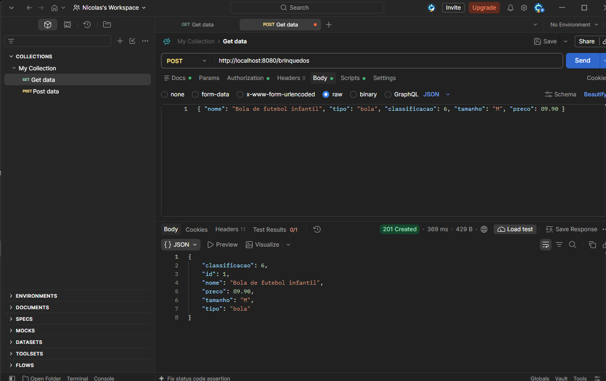

**POST /brinquedos/lote** (admin) – envia uma lista com 3 brinquedos, gravados de uma vez.
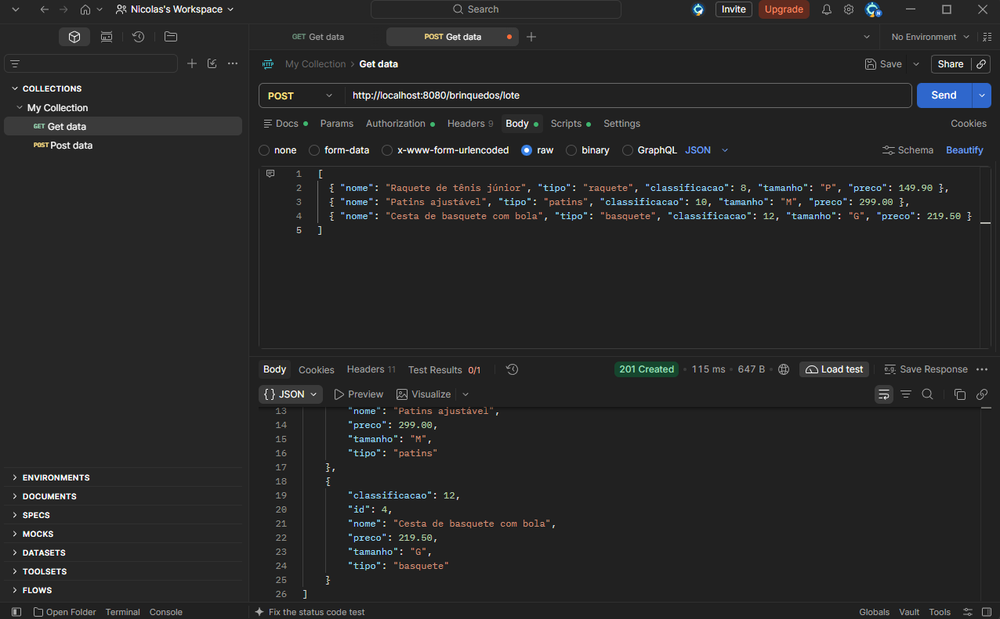

### Read

**GET /brinquedos** (user) – lista todos os brinquedos: **200 OK**.
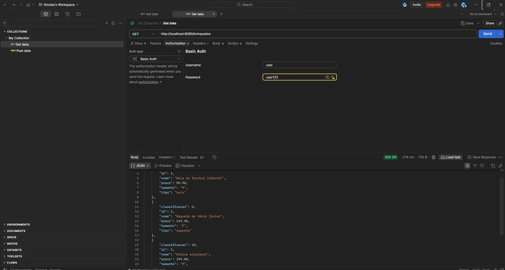

**GET /brinquedos/2** – busca por id: **200 OK**.
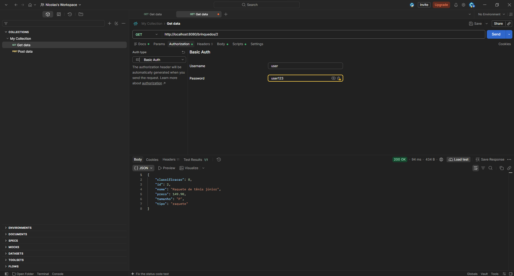

**GET /brinquedos/99** – id inexistente: **404 Not Found**.
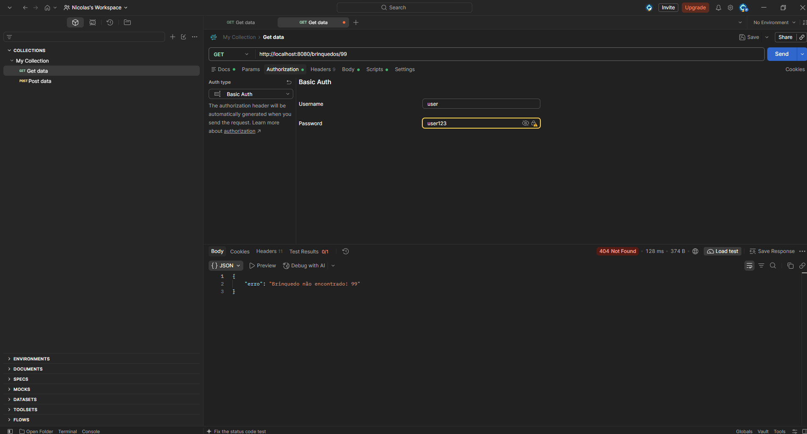

**GET /brinquedos?tipo=patins** – filtro por tipo (consulta derivada).
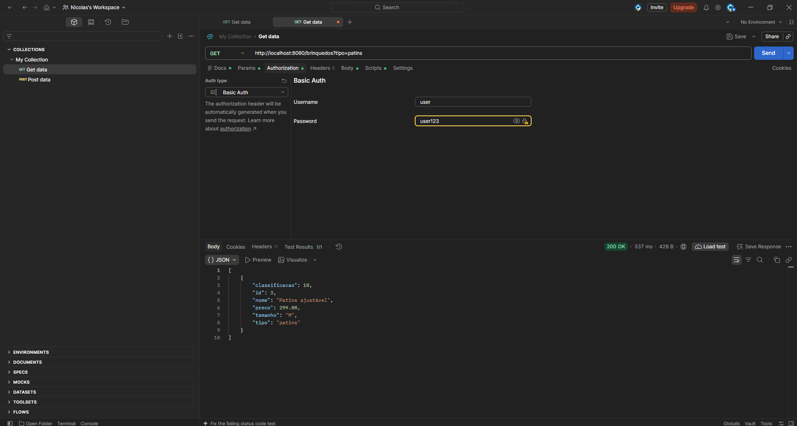

### Update

**PUT /brinquedos/1** (admin) – preço alterado de 89.90 para 79.90: **200 OK**.


**PUT /brinquedos/99** – id inexistente: **404 Not Found**.
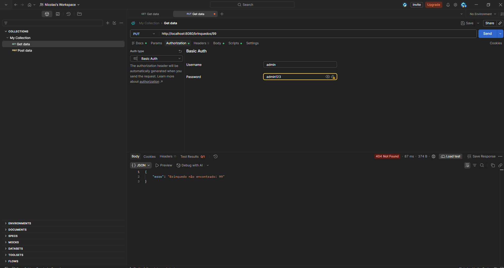

### Delete

**DELETE /brinquedos/4** (admin) – exclusão pelo id: **204 No Content**.
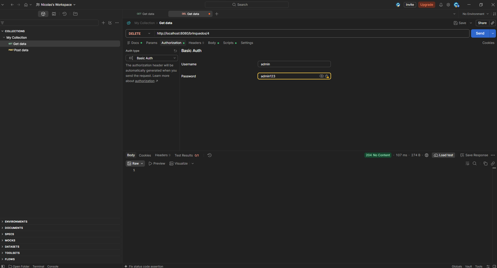

**GET /brinquedos/4** após a exclusão – confirma que o registro saiu do banco: **404**.
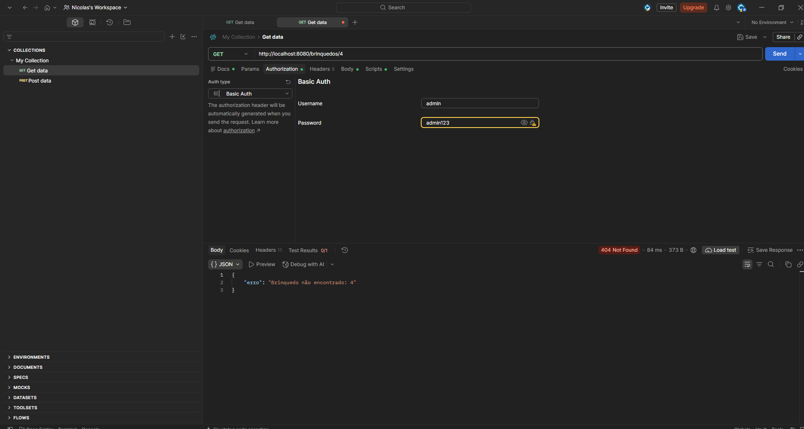

### Segurança e validação

**POST com o perfil USER** – **403 Forbidden**, pois só ADMIN pode criar.
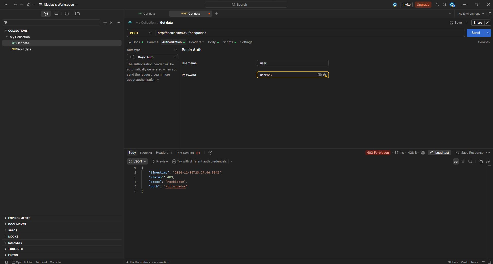

**Requisição sem login** – **401 Unauthorized**.
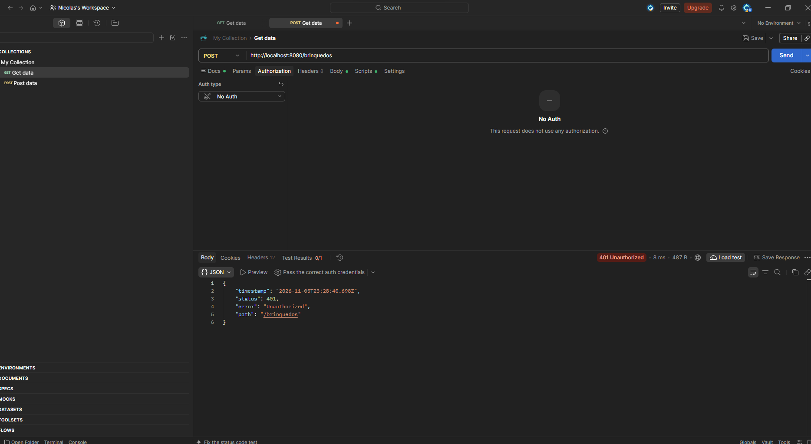

**POST com dados inválidos** (nome vazio, classificação 20, tamanho X, preço negativo) – **400 Bad Request** com a mensagem de cada campo.
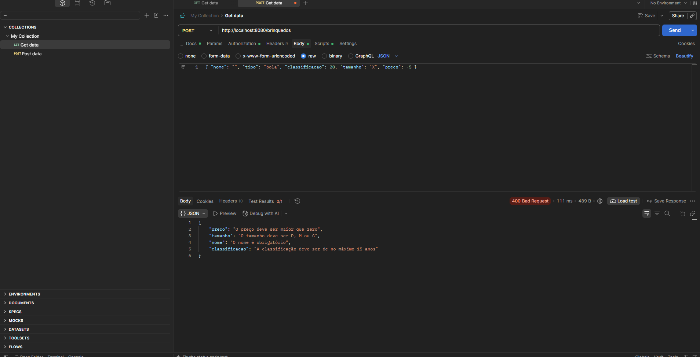

## 10. Interface web (Thymeleaf)

| Página | Endereço | Acesso |
|---|---|---|
| Landing page | `/` | pública |
| Login | `/login` | pública |
| Painel com o catálogo | `/painel` | usuários logados |

- O `PaginaController` (`@Controller`) devolve o nome do template HTML, enquanto o `BrinquedoController` (`@RestController`) devolve JSON.
- O formulário de login usa `th:action="@{/login}"`, que inclui automaticamente o token CSRF.
- O painel lista os brinquedos do banco com `th:each` e mostra conteúdo diferente para cada perfil com `th:if` / `th:unless`.

**Landing page pública**
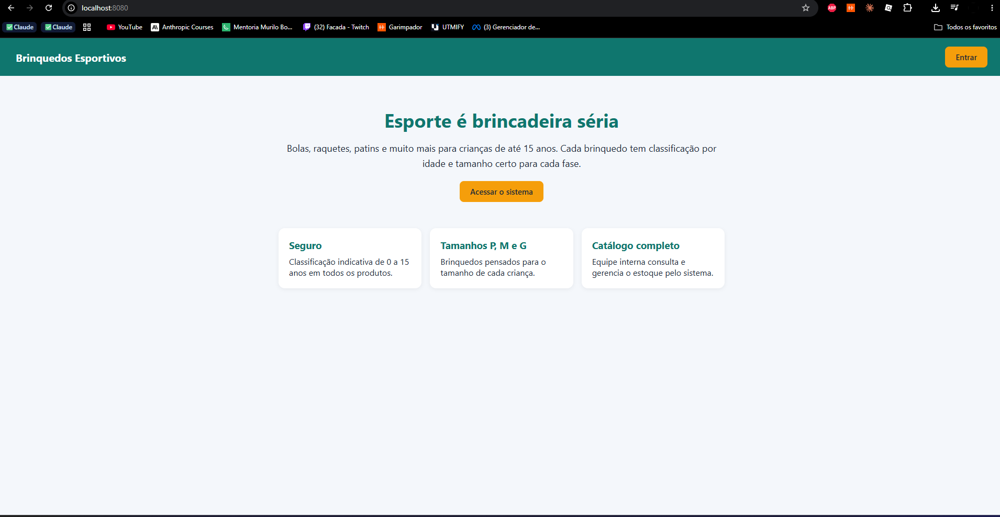

**Tela de login**
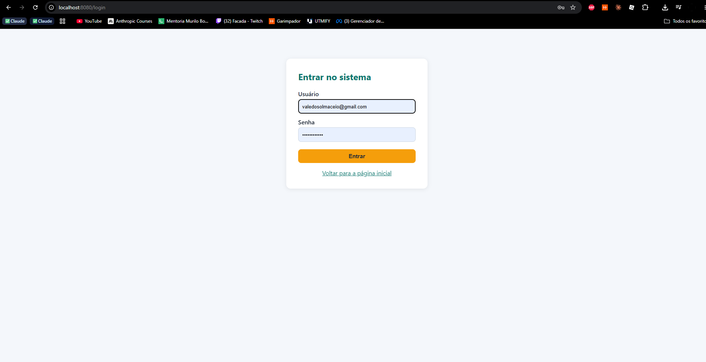

**Painel – perfil ADMIN**
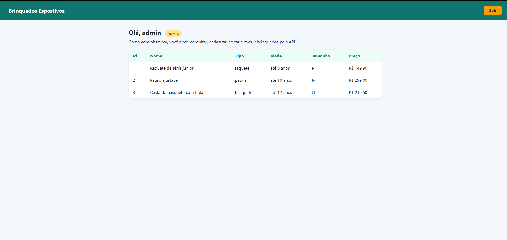

**Painel – perfil USER**
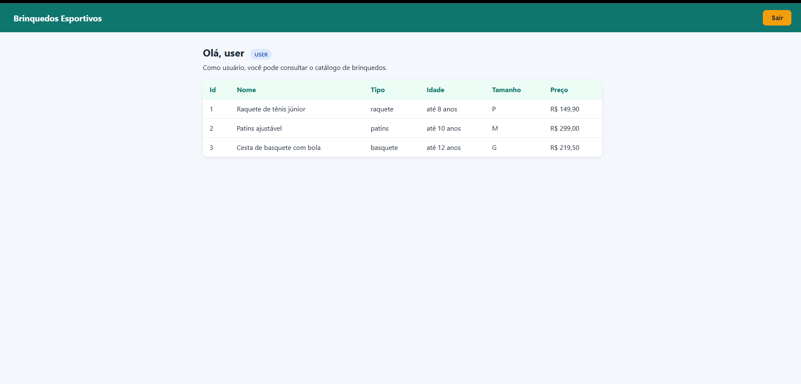
